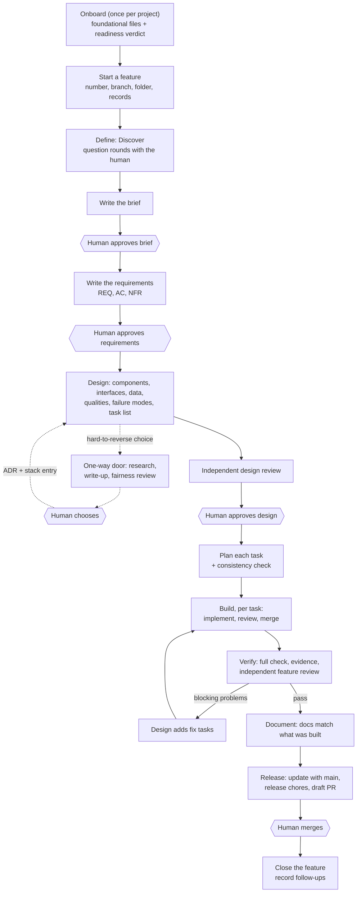

# sdd-kit

**A spec-driven development (SDD) methodology for AI coding agents, packaged as a set of skills.**

sdd-kit gives an AI coding agent a structured way to build software. A project is onboarded once. After that, every feature starts as a written specification the human approves. It is then designed, built task by task, verified, and documented, and it ends as a draft pull request that only the human merges. Each step leaves a versioned file in the repository, so the work can be reviewed, traced, paused and resumed by anyone, in any session.

sdd-kit is **the core methodology, not a complete ecosystem**. It sets the development process: the phases, the artifacts, the approvals, the reviews and the traceability. It does not try to teach the agent every framework, architecture style or engineering practice, and it does not ship integrations. Those come from the skills, tools and MCP servers you already use, or choose to add. A project records the skills it relies on in a catalogue, and every phase loads the ones that apply. You keep your existing open-source and proprietary skills, your tools and your practices. **The methodology organizes the process. The ecosystem around it makes the agent capable.**

> **Status:** early (`version 0.1.0`). The methodology is defined as instructions and templates. Nothing in the repository enforces it with code: there are no scripts, hooks or validators yet. Today it runs as a [Claude Code](https://code.claude.com) plugin, installed from [sdd-marketplace](https://github.com/daniel-torresc/sdd-marketplace). See [Current capabilities and limitations](#current-capabilities-and-limitations).

---

## Contents

- [Why a methodology for AI-assisted development](#why-a-methodology-for-ai-assisted-development)
- [What sdd-kit is, and what it is not](#what-sdd-kit-is-and-what-it-is-not)
- [Principles](#principles)
- [A foundation you build on](#a-foundation-you-build-on)
- [How it works](#how-it-works)
- [The phases in detail](#the-phases-in-detail)
- [Review and research](#review-and-research)
- [When something changes or goes wrong](#when-something-changes-or-goes-wrong)
- [Artifacts](#artifacts)
- [Repository structure](#repository-structure)
- [The agent's role and the developer's role](#the-agents-role-and-the-developers-role)
- [Getting started](#getting-started)
- [Configuration and customization](#configuration-and-customization)
- [Quality controls, traceability and governance](#quality-controls-traceability-and-governance)
- [Why it is useful](#why-it-is-useful)
- [Current capabilities and limitations](#current-capabilities-and-limitations)
- [Future work](#future-work)
- [Contributing](#contributing)
- [Glossary](#glossary)
- [License](#license)

---

## Why a methodology for AI-assisted development

AI coding agents write code quickly. Used without structure, they also tend to fail in the same ways again and again:

- **They build before the problem is understood.** The agent starts coding from a one-line request and fills every gap with a guess.
- **Requirements stay implicit.** Nobody writes down what "done" means, so nobody can check it.
- **Decisions come too early, or silently.** A datastore, a framework or a public interface gets picked mid-task, and nobody approved it.
- **Context is lost between sessions.** What was agreed yesterday lives in a conversation that no longer exists.
- **Changes are hard to review against intent.** A large diff arrives with no record of what it was meant to do.
- **Traceability is weak.** You can't tell which requirement a piece of code serves, or which test proves a requirement holds.
- **Scope grows.** "While I'm here" changes and speculative features make the change bigger than what was asked.

Spec-driven development answers these by putting a written, approved specification at the start of every piece of work, and checking everything built afterwards against it. sdd-kit's version of SDD is built specifically for working with AI agents:

- Every step reads from files and writes to files, never relying on memory.
- The human approves at a few explicit points.
- Reviews run independently of the work's author.
- IDs link every requirement to the design, the tasks, the tests and the evidence.

---

## What sdd-kit is, and what it is not

| sdd-kit **is** | sdd-kit **is not** |
|---|---|
| A methodology: principles, phases, approvals, reviews, traceability rules | A framework, a library, or a code generator |
| A set of agent skills that run each phase | An autonomous system that guarantees correct software |
| 16 templates for the files a project and its features keep | A collection of technology, architecture or testing guidance |
| A way to record which external skills a project relies on, and when to load them | A skill installer or discovery service. Curated plugins are listed separately, in [sdd-marketplace](https://github.com/daniel-torresc/sdd-marketplace) |
| A process that works alongside your MCP servers, tools and CI | A set of integrations, MCP servers or CI pipelines |

The methodology is technology-agnostic. It doesn't prescribe a language, an architecture style, a testing strategy such as TDD, or a branching model. Each project writes down its own choices in its foundational files.

---

## Principles

The methodology rests on ten principles, defined in [`skills/sdd-methodology/SKILL.md`](skills/sdd-methodology/SKILL.md). Each one exists to prevent a specific failure:

| # | Principle | Why it exists |
|---|---|---|
| 1 | **Specify before building.** What and why are agreed before how; how is agreed before anything is built. | Stops the agent from coding from a guess. |
| 2 | **The approved specification is the source of truth.** | Gives every later step something objective to be checked against. |
| 3 | **The human decides what matters:** intent, scope, risk, cost, legal matters, hard-to-reverse choices. Everything else is decided along the way. | Keeps humans in control without making them approve every detail. |
| 4 | **Make the implicit explicit.** Assumptions, decisions and open questions are written down with their reasons. | A gap becomes a recorded assumption that someone can overturn, not a silent guess. |
| 5 | **Everything is traceable.** | You can ask which test proves a requirement, and get an answer. |
| 6 | **Evidence over assertion.** | "Done" means checks and reviews show it, not that the agent says so. |
| 7 | **Review is independent.** Work is judged against its sources, never its author's explanation. | Prevents a reviewer from being talked into approving. |
| 8 | **Changes propagate.** Whatever is derived from a changed artifact is checked again. | Stops designs and code from drifting away from revised requirements. |
| 9 | **The record outlives the work session.** All state lives in versioned files. | Work can pause, resume, or change hands at any point. |
| 10 | **Small, verifiable steps.** | Each task is small enough to build, review and verify on its own, and the system keeps working after each one. |

---

## A foundation you build on

This is the most important idea in sdd-kit: **the methodology provides the structure; skills and tools provide the knowledge and capabilities inside that structure.** They do different jobs, so you need both.

| Layer | What it provides | Where it comes from |
|---|---|---|
| **The methodology** (this repository) | The process: phases, artifacts, approvals, reviews, traceability, how to resume | `sdd-kit` |
| **Skills** | Specialized knowledge: how to apply hexagonal architecture, how to write good tests, how to use LangChain or Pydantic well, your company's API standards | Official, community, or your own skills, installed in your agent |
| **Tools and integrations** | Capabilities: access to issue trackers, documentation, databases, cloud consoles, browsers, CI | MCP servers, CLIs and tools configured in your agent |
| **Project configuration** | Your project's choices: principles, practices, stack, commands, which skills apply where | The foundational files in `.sdd/` of your project |

A few examples show how the layers fit together:

- **Architecture.** A hexagonal-architecture skill explains how to separate the domain from its adapters. The methodology decides when that knowledge is used: when the feature is designed, when each task is built, and when the change is reviewed.
- **Testing.** A TDD or testing skill helps the agent write effective tests. The methodology says that every acceptance criterion needs a test that names its ID, that a task is reviewed before it is merged, and that Verify shows which test proves each criterion. Test-first itself is a practice your project can require in its constitution; the methodology doesn't impose it.
- **Frameworks.** A LangChain or Pydantic skill provides framework-specific implementation knowledge. The methodology structures the feature that uses the framework.
- **Documentation.** A skill for your company's runbook format tells the agent how a runbook must look. The documentation catalogue says the runbook must be updated whenever a feature changes deployment, and Document does it.
- **Tools.** An issue-tracker or documentation MCP server lets the agent read tickets or look things up. The methodology doesn't need to know about it; the agent uses it wherever it helps.

### How skills are connected to the methodology

Skills are not bundled with sdd-kit and are not discovered automatically. The connection is a file in your project, the **skills catalogue** (`.sdd/skills.yaml`):

1. **At onboarding,** the agent works out which technologies, patterns, principles and practices matter to the project. It proposes skills that support them, drawn from the skills your session already lists as available, and it asks which skills you already use or want to install. It never scans your machine for them.
2. **You decide.** For each candidate you approve, reject or defer it. Approved skills are recorded with what they cover and the phases they apply to. A skill you want but haven't installed is recorded with how to get it. Installing it is up to you.
3. **In every phase,** the agent loads the approved entries whose `use-when` includes the current phase and whose `covers` touches the work. In Build, each task in the plan also names the skills to load for it.
4. **The project's files win.** If a skill's advice conflicts with your constitution, architecture or requirements, your file applies, and the conflict is recorded.
5. **A missing skill doesn't block.** If a listed skill isn't available in the session, the agent reports it and carries on without it.
6. **New skills need your approval.** Any phase may propose a skill through a decision entry. It is added only once you agree.

Any skill your agent can load can be listed, including ones from other repositories or private ones. sdd-kit can't guarantee how good, or how compatible, a third-party skill is.

### Tools and MCP servers

The methodology doesn't reference, configure or record MCP servers or other tools, and the plugin's own `.mcp.json` is empty. Tools you configure in your agent stay available during every phase, and the agent uses them as it normally would. Two places in your project's files do touch tooling:

- `stack.yaml` lists the **commands** used to install, test, check, build and run the project. Build, Verify and Release run those commands.
- The constitution's **practices** can state how a tool must be used, for example "every pull request is opened with the GitHub CLI".

No foundational file catalogues tools the way `skills.yaml` catalogues skills (see [Future work](#future-work)).

---

## How it works

There are two levels: **onboarding**, once per project, and **the feature lifecycle**, once per feature.



Hexagons are human decisions. Within a feature, each phase starts only when the one before it has finished, and each phase skill checks that before it starts. There are only two ways back: blocking problems found in Verify (or later, on the pull request) become **fix tasks** that go through Build again, and an approved artifact that turns out to be wrong can be corrected at any point, after which everything built on it is checked again.

### Where the human is involved

| Moment | What the human does |
|---|---|
| Onboarding | Answers the interview, makes or defers the foundational decisions, and approves the skills and documents the project relies on |
| Discover | Answers question rounds, each question with a recommended answer, or says "use your recommendations" |
| Brief, requirements, design | Approves each one, asks for changes, or rethinks |
| One-way doors | Chooses between options presented with a fair comparison |
| Disputes and non-converging reviews | Decides how to proceed |
| Unverifiable qualities | Accepts them as a recorded risk, or provides what is needed to verify them |
| Required documents with missing information | Supplies it |
| New skills or catalogued documents | Approves them |
| The pull request | Reviews it, comments, and merges. **Merging into main is always the human's act.** |

The agent decides everything else inside the approved scope, such as how to structure components, which library to use within the chosen stack and how to implement a behaviour. It records the notable choices so you can review them.

---

## The phases in detail

Each phase is a skill you invoke. Every phase skill:

- loads `sdd-methodology` and reads the templates it will fill;
- resumes from the feature's records if the phase was interrupted;
- takes a **checkpoint** after every step: it appends to `decisions.md`, overwrites `state.yaml` and commits on the feature branch;
- ends with a report of where the feature stands and what is waiting for you.

### Onboard: once per project

**Skill:** `sdd-onboarding` · **Purpose:** establish the project-wide context every feature builds on, so that no feature has to invent it.

- **Inputs:** your description of the project; any existing documents, diagrams or standards; in an existing codebase, the repository itself.
- **Activities:** the agent reads the templates first, then works out whether the project is greenfield, brownfield or mixed. For a brownfield project it inventories the repository, including its structure, dependencies, tests, CI, deployment and existing docs. It then interviews you across four areas: the product's context and scope, the stack and the technical decisions, engineering principles and practices (version control included), and the skills and documents the project relies on. It consolidates what it learned, asks you to correct it, writes the files and validates them as a set.
- **Rules worth knowing:** existing code counts as evidence of what the system does, not as a standard to copy. Current state, intended state and technical debt are kept apart. A decision can stay open when nothing yet depends on it. Replacing or restructuring existing foundational files needs your confirmation.
- **Outputs:** the six [foundational files](#project-files), and a **readiness verdict**:
  - **READY:** the files are coherent and complete enough to start.
  - **READY WITH CAVEATS:** you can start, but named gaps need attention in the phases they affect.
  - **NOT READY:** a material gap or contradiction blocks a reliable start, and the verdict says what must be resolved.
- **Done when:** the files follow their templates, are consistent with each other, and the verdict is supported by what they actually contain, not by the fact that they exist.

Onboarding can be run again at any time to review or update the foundational files.

### Define: what and why

**Skill:** `sdd-define` · **Purpose:** agree with you on the problem, the users, what success looks like and exactly what the feature must do, before anyone thinks about how.

- **Inputs:** your request; the product description, the constitution, the stack, and earlier features that touch the same area.
- **Activities:**
  1. **Open the feature:** it gets the next free number (`F003`), a short name, a branch from the latest main named as your constitution says, and a folder `specs/003-<slug>/` holding `state.yaml` and `decisions.md`.
  2. **Discover:** for every unknown, the agent decides whether the files answer it, whether it needs research, whether it can be a recorded assumption, or whether only you can answer it. Your questions come in rounds. Each question says why it matters and gives a recommended answer. Answers are recorded word for word, and nothing is asked twice. There is no fixed number of rounds: the loop ends when nothing important is open, or when you say "use the recommendations".
  3. **Brief:** the problem, the users, the desired outcome, success criteria (`SC-nn`) with baselines and targets, scope and non-goals, constraints (`CON-nn`), assumptions, open questions and risks. You approve it.
  4. **Requirements:** functional requirements (`REQ-nn`), written in EARS patterns ("When …, the system shall …"), each with acceptance criteria (`AC-nn.m`) concrete enough that anyone could check them, plus measurable qualities (`NFR-nn`), each stating how it will be verified. You approve them.
- **Quality controls:** Define never chooses technologies or components. The requirements are checked for coverage of the brief, unambiguous wording and observability before they reach you. Growth beyond the smallest valuable slice is named, and you decide what stays in scope.
- **Done when:** both the brief and the requirements are approved. From here on they are **the contract**.

### Design: how to build it

**Skill:** `sdd-design` · **Purpose:** decide how the feature will be built, prove the approach holds up before any code exists, and split the work into small tasks.

- **Inputs:** the approved brief and requirements, the foundational files, the existing ADRs and code, and any research notes.
- **Activities:**
  1. **Understand what the design must fit:** the existing system, the requirements that shape the design most, the constraints and the unknowns. Unknowns that matter are researched.
  2. **Write the design:** components (`C-nn`), interfaces (`IF-nn`), data, technologies, how each quality is met and verified, failure modes, decisions with the alternatives considered, and a **task list** (`T-nn`) in which every acceptance criterion is delivered by some task.
  3. **One-way doors:** a hard-to-reverse choice, such as the stack, the main datastore, hosting, identity, a public interface or anything that costs money, is not made by the agent. It is researched independently with every viable option compared, written up with a non-binding recommendation, reviewed for fairness, and put to you. Your choice becomes an ADR and a `stack.yaml` entry.
  4. **Design review:** an independent review against the brief, the requirements, the research and earlier decisions, repeated until it approves or until you decide how to proceed.
  5. **Design approval:** you approve the design and its task list.
  6. **Plan:** for each task, what it delivers, what it implements, its dependencies, the stack concerns, skills and files it involves, its approach, how it is checked, and its risks. No code. The plan then gets a consistency check: every criterion is delivered, every task is fully specified, there are no dependency cycles, and parallel tasks don't touch the same files.
- **Rules worth knowing:** design prefers the simplest approach and reuses what exists. Technologies you marked `fixed` are never changed. A requirement that can't be met is sent back to Define, not worked around.
- **Done when:** the design is approved and the plan's status is `checked`.

### Build: one task at a time

**Skills:** `sdd-build` coordinates, `sdd-implement` builds each task, `sdd-review` reviews it. · **Purpose:** turn the plan into working code, keeping the feature branch working after every merge.

- **Inputs:** the approved design, the checked plan, the constitution, and the `stack.yaml` commands.
- **Activities:**
  1. **Baseline:** the full test suite and checks run first, and pre-existing failures are recorded as `known-failures`, so a task is judged only on what it changes.
  2. **Task loop:** a task starts when every task it depends on is merged. By default up to three tasks run in parallel; your constitution or your input can change that limit. Each task is implemented in its **own subagent, working copy and branch**. It is built with tests that name the acceptance criteria they prove (`F003:AC-02.1`), following the constitution, the stack and the skills the task names. Work outside the task is reported, not done.
  3. **Task review:** a separate subagent reviews the change against the task, its criteria, the design and the constitution. Blocking findings are fixed and reviewed again.
  4. **Merge:** approved tasks merge into the feature branch one at a time, and the full suite runs after each merge. If anything fails, the merge is undone and the task goes back to be fixed.
- **Rules worth knowing:** Build never changes the requirements, the design or the plan. A blocked task holds only itself and the tasks that depend on it, and everything else keeps going.
- **Done when:** every task is merged, every acceptance criterion has a test that names it, and the full suite passes with no failures beyond the known ones.

### Verify: the whole feature

**Skill:** `sdd-verify` · **Purpose:** confirm that the feature as a whole does what the requirements say, independently of how each task was built.

- **Activities:**
  1. **Full check:** every project check runs on the feature branch. A **traceability matrix** links each acceptance criterion to the tests that name it and their results. Each quality is verified as its requirement says. Everything is recorded in `evidence/README.md`.
  2. **Feature review:** an independent review of the full difference from main, against the requirements, the design and the evidence.
- **Rules worth knowing:** only results from checks that actually ran count. A flaky test counts as a failure. A quality that can't be verified in the available environment goes to you, never passes silently. Verify changes no code.
- **Outcome:** if everything passes, the feature moves to Document. If something fails, Design adds fix tasks, Build builds them, and Verify runs again from the start.

### Document: the docs match what was built

**Skill:** `sdd-document` · **Purpose:** bring documentation in line with what was built, not with what was planned.

- **Updates:** the product and architecture descriptions; every entry in the **documentation catalogue** whose `update-when` trigger matches the feature, in the structure that document requires; and anything else named in the documentation impact collected during Build.
- **Rules worth knowing:** where the code and the specification differ, the documentation follows the code, and the gap is reported to you. A required document that can't be completed with the information available goes to you, and is never skipped.

### Release: the human merges

**Skill:** `sdd-release` · **Purpose:** hand the feature to you with everything you need to decide, and close it once merged.

- **Activities:**
  1. Bring the branch up to date with main, then re-run the suite and the checks. Conflicts and new failures become fix tasks; Release never fixes code itself.
  2. Do the release chores your practices or catalogue require, such as a version bump, a changelog entry or release notes. The method itself requires none.
  3. Push the branch and open a **draft pull request**. Its description says what the feature does, links the specification and the evidence, lists your decisions and the ADRs, states **what you accept by merging** (assumptions, open risks, unverified qualities, known failures), names the documentation updated, and explains how to try it. With no remote, the branch itself is the handover.
  4. While the pull request is open, failing checks become fix tasks. Your comments are recorded and routed: a fix within the approved approach becomes a fix task, a change to the requirements goes back to Define, and a question is answered.
  5. Once you merge, the feature is closed, the branch is cleaned up as your practices say, and its **follow-ups** are recorded as candidates for later features.
- **Rules worth knowing:** Release never merges into main and never pushes to it. Deployment is your own process, after the merge, and is outside the method.

---

## Review and research

Two activities aren't phases. Any phase calls on them, and both run **independently** of the work they serve. They normally run in a subagent that receives only file paths: never the author's reasoning, and never the option the author leans towards.

### Review (`sdd-review`)

| Review | What is reviewed | Judged against | Phase |
|---|---|---|---|
| Design review | the design and its task list | brief, requirements, research, decisions, foundational files, ADRs | Design |
| Fairness review | the write-up of a one-way door | the research note, requirements, constraints | Design |
| Task review | one task's change | the task, its criteria, the design, the constitution, the stack | Build |
| Feature review | the full difference from main | requirements, design, evidence | Verify |

- **Findings:** each finding is `blocking` or `minor`. A blocking finding must carry concrete evidence, or it is downgraded to minor. Anything that would add scope is minor.
- **Verdicts and answers:** the verdict is `approve` or `changes-required`. Every finding gets one answer in a separate answers file: fixed, or rejected with a reason grounded in the sources. Review files are never edited.
- **Rounds:** each later round checks the earlier findings, then looks only at what changed. If the rounds stop converging, or a rejection is still disputed, the decision goes to you.
- **Defects found elsewhere:** any phase that finds a defect in an artifact it doesn't own records it in a findings file using the same format.

### Research (`sdd-research`)

Research answers one question that needs outside knowledge, such as the domain, a regulation, how a library behaves, or the options for a decision. It prefers primary sources, cites everything, keeps facts apart from inferences, and states its confidence as high, medium or low. For a choice, it compares every viable option with the same depth. It writes one research note, and it **informs** decisions without ever making them. Notes on regulation say plainly that they are not legal advice.

---

## When something changes or goes wrong

- **A defect in an artifact** is recorded as a finding, and the work continues where it can.
- **A change to an approved artifact** bumps its version. Everything built on the older version becomes **stale** and is checked again. A fix within what you approved needs no new approval. A change to scope, intent or the approved approach comes back to you.
- **A problem belongs to the phase that produced it.** Build and Verify never patch the requirements or the design; they send findings back to Define or Design, and only the affected tasks wait.
- **A question only you can answer** is recorded as an open entry in `decisions.md` with a recommended answer. Work that doesn't depend on it continues. When nothing else can proceed, the feature waits with status `waiting-for-human`.
- **Sessions end.** Every phase resumes from `state.yaml`, then from the open entries in `decisions.md`, then from the artifacts at the versions those name. If the records and the artifacts disagree, the agent stops and reconciles them first.

---

## Artifacts

All artifacts live in your project, not in sdd-kit. Each starts from a template in [`skills/sdd-methodology/templates/`](skills/sdd-methodology/templates/), and the agent keeps the template's structure: its frontmatter, its headings and their order. The full rules are in [`references/artifacts.md`](skills/sdd-methodology/references/artifacts.md).

```
<your-project>/
├── .sdd/                          foundational files: the project as a whole
│   ├── constitution.md            principles, non-negotiable constraints, practices
│   ├── stack.yaml                 technologies (human-fixed and decided) and project commands
│   ├── product.md                 what the product is, for whom, what it does, its domain rules
│   ├── architecture.md            how the system is built, its conventions and debt
│   ├── skills.yaml                the skills the project relies on, and when each applies
│   └── documentation.yaml         the documents the project must keep current, and when
├── docs/
│   └── adr/ADR-NNNN-<slug>.md     one architecture decision each
└── specs/
    └── NNN-<slug>/                one folder per feature (feature ID F<NNN>)
        ├── state.yaml             where the feature stands
        ├── decisions.md           every question, answer and decision (append-only)
        ├── brief.md               problem, users, outcome, success, scope
        ├── requirements.md        behaviour, acceptance criteria, qualities
        ├── research/Q-nn-<slug>.md one note per researched question
        ├── design.md              how it is built, and the task list
        ├── plan.md                how to approach each task
        ├── reviews/               one file per review round, plus answers
        └── evidence/README.md     check results and the traceability matrix
```

### Project files

All six foundational files are required. Each holds one kind of knowledge, and no fact is kept in two of them.

| File | Purpose | Created | Updated by |
|---|---|---|---|
| `constitution.md` | Principles (`PR-nnn`), non-negotiable constraints (`NC-nnn`), practices (`EP-nnn`) including version control, quality expectations, governance | Onboard | Only deliberately, with the human |
| `stack.yaml` | Each technology by concern, with status and who decided it; `fixed: true` marks human constraints; `commands:` for install, test, check, build, run | Onboard | Design adds or updates entries |
| `product.md` | Purpose, users, capabilities, domain concepts, business rules, scope, current state | Onboard | Document |
| `architecture.md` | Components, interactions, data, cross-cutting concerns, deployment, debt, mapping to code | Onboard | Document |
| `skills.yaml` | The skills the project relies on: what each covers, in which phases, why, and where it comes from | Onboard | Entries added once the human approves |
| `documentation.yaml` | The other documents the project must keep current: why, who requires them, what triggers an update, the required format | Onboard | Document updates the listed documents; entries added once the human approves |
| `docs/adr/ADR-NNNN-*.md` | One significant decision: context, options, choice, consequences, `decided-by: human \| design` | Design | Superseded by a later ADR, never rewritten |

### Feature files

| File | Purpose | Created in | Built from |
|---|---|---|---|
| `state.yaml` | Phase, step, status, next action, what is waiting, task statuses, known failures, stale files, history | Feature start; overwritten at every checkpoint | — |
| `decisions.md` | Human decisions (`H-nn`), Discover questions (`Q-nn`), choices made along the way, documentation impact | Feature start; append-only | — |
| `brief.md` | The problem and the intended outcome | Define | the request and the answers |
| `requirements.md` | Observable behaviour and how to check it | Define | `brief.md` |
| `research/Q-nn-*.md` | One answered question with evidence and confidence | Any phase | — |
| `design.md` | Components, interfaces, data, qualities, failure modes, task list | Design | `brief.md`, `requirements.md` |
| `plan.md` | How each task is approached and checked | Design | `design.md`, `requirements.md` |
| `reviews/*.md` | One review round's findings and verdict, plus the answers file | Design, Build, Verify | the reviewed file |
| `evidence/README.md` | One Verify run: checks, traceability matrix, qualities, failures, limits | Verify | `requirements.md`, `design.md`, `plan.md` |

### Versions and staleness

The brief, the requirements, the design and the plan carry this frontmatter:

```yaml
---
artifact: design
feature: F003
status: approved          # draft | approved | superseded (the plan uses "checked")
version: 3                # bumped on every change after the first review or approval
upstream: [brief.md@2, requirements.md@4]   # the versions this one was built from
---
```

When a file's `version` is higher than the version another file lists for it in `upstream`, that other file is **stale**. It is either confirmed, by bumping its `upstream`, or revised.

### IDs and traceability

IDs are local to a feature, and across features they are prefixed with the feature ID (`F003:REQ-02`). They are never reused or renumbered; an item that no longer applies is marked `[withdrawn]`. Links point upward, from what was built to what it was built for:

```
requirement (REQ-02) ◄── acceptance criterion (AC-02.1) ◄── task (T-04) ◄── test, commit
        ▲
        └── component / interface (C-01, IF-02)
```

A test names the criterion it proves with its full ID, for example in its name or docstring, using `F003:AC-02.1`. That is how Verify builds the traceability matrix.

Other IDs: `SC` (success criterion), `CON` (constraint), `REF` (reference), `NFR` (quality), `OQ` (open question), `ASM` (assumption), `RISK`, `H` (decision for the human), `Q` (Discover question or research note), `R<round>-nn` (review finding), and `ADR-NNNN`, which is numbered across the whole project.

### Approvals are recorded twice

An approval is recorded as the answer to its `H-nn` entry in `decisions.md`, with the date, the version approved and your words; that is the proof. It is mirrored in the artifact's `status: approved`. If the two disagree, `decisions.md` is correct.

---

## Repository structure

sdd-kit is a Claude Code plugin made entirely of skills: Markdown instructions and templates. It contains no executable code.

```
sdd-kit/
├── .claude-plugin/plugin.json     plugin manifest (name, description, version, author)
├── skills/
│   ├── sdd-methodology/           THE METHODOLOGY (reference, not a command)
│   │   ├── SKILL.md               principles, phases, layout: the summary
│   │   ├── references/
│   │   │   ├── methodology.md     the method in full: every phase and step
│   │   │   └── artifacts.md       every file, template rule, version, ID, record, catalogue
│   │   └── templates/             16 templates for project and feature files
│   ├── sdd-onboarding/SKILL.md    Onboard
│   ├── sdd-define/SKILL.md        Define
│   ├── sdd-design/SKILL.md        Design
│   ├── sdd-build/SKILL.md         Build (coordinator)
│   ├── sdd-implement/SKILL.md     one task: implement, fix review findings, fix a failed merge
│   ├── sdd-review/SKILL.md        one independent review round
│   ├── sdd-research/SKILL.md      one independent research question
│   ├── sdd-verify/SKILL.md        Verify
│   ├── sdd-document/SKILL.md      Document
│   └── sdd-release/SKILL.md       Release
├── .mcp.json, .lsp.json, settings.json   empty placeholders
└── README.md
```

### How the components work together

- **`sdd-methodology` defines; the other skills execute.** The methodology skill describes the method and the files, and holds the templates. It names no roles and says nothing about who runs what. Every other skill must load it, and treats its templates as the authority on structure. That is why the phase skills name no file paths: the set of files is defined in one place and can change.
- **Phase skills** (`sdd-onboarding`, `sdd-define`, `sdd-design`, `sdd-build`, `sdd-verify`, `sdd-document`, `sdd-release`) each run one phase end to end. They check its preconditions, resume from the records, take checkpoints and report.
- **Shared skills** (`sdd-implement`, `sdd-review`, `sdd-research`) do one unit of work each. A phase starts them in a **subagent** that gets only the feature, the IDs and the file paths, so the work stays independent. Each one documents how a phase should start it, in its last section. You can also invoke them directly, for example to review a specific task.
- **Activation.** In Claude Code, every skill except `sdd-methodology` is a slash command. Skills also load automatically when your request matches their description, so "let's design feature 3" works too. `sdd-methodology` is hidden from the menu (`user-invocable: false`) and loads whenever the method or its files are needed.
- **Permissions.** Each skill pre-approves only reading files and inspecting git, plus web search for `sdd-research` and `git fetch` for `sdd-release` (`allowed-tools`). Writing files, committing, running tests, pushing and opening pull requests go through your agent's normal permission prompts.

You normally don't modify anything in sdd-kit to use it. Your project's configuration lives in your project's `.sdd/` folder.

---

## The agent's role and the developer's role

**The agent:**

- loads the methodology and the templates before producing anything;
- reads the foundational files before asking you anything, and never asks what the files already answer;
- fills gaps that aren't yours to decide with recorded assumptions, which you see at the next approval;
- loads the skills the catalogue lists for the phase and the work, and proposes new ones when they would help;
- decides reversible, in-scope details itself, and records the notable ones;
- puts every decision that belongs to you to you, with a recommended answer;
- starts reviews, research and task implementations in separate subagents;
- keeps the running records and commits them at every checkpoint;
- reports honestly, never claiming that a check ran, a test passed or something was approved unless it did.

**You:**

- own the intent, the scope, the priorities and the definition of success;
- answer Discover questions and approve the brief, the requirements and the design;
- make one-way-door choices, and settle disputes and non-converging reviews;
- choose which skills, documents and practices the project uses, and install the skills you want;
- review the pull request and the changes it contains, and merge it;
- remain responsible for the software. The methodology makes the agent's work explicit and reviewable; it does not make the agent infallible.

**Specific to the agent integration:** subagents, separate working copies, the `allowed-tools` frontmatter, `$ARGUMENTS` in the skills and the plugin manifest are Claude Code mechanisms. The methodology itself, meaning the principles, the phases, the files and the IDs, doesn't depend on them. Where a subagent isn't available, `sdd-review` and `sdd-research` say to run the review or research in a fresh session, and to state when independence was limited.

---

## Getting started

### Prerequisites

- **[Claude Code](https://code.claude.com).** sdd-kit is a Claude Code plugin; no other agent is supported or tested today.
- **A git repository** for your project.
- **Optional:** a remote, and a way for the agent to push and open pull requests (for example the GitHub CLI). Without one, Release hands over the feature branch instead of a pull request.
- **Optional:** the skills and MCP servers you want the project to use, installed in Claude Code.

### Install

sdd-kit is distributed through **[sdd-marketplace](https://github.com/daniel-torresc/sdd-marketplace)**, a Claude Code plugin marketplace that also lists plugins curated to work alongside sdd-kit. In a Claude Code session:

```
/plugin marketplace add daniel-torresc/sdd-marketplace
/plugin install sdd-kit@sdd-marketplace
```

The same commands work from your shell as `claude plugin marketplace add …` and `claude plugin install …`. On Claude Code 2.1.275 or later, a single command does both:

```
/plugin install sdd-kit --marketplace daniel-torresc/sdd-marketplace
```

To give everyone working in a repository the marketplace, run `claude plugin marketplace add daniel-torresc/sdd-marketplace --scope project` once in that repository and commit the `.claude/settings.json` it writes. If you have no GitHub SSH key, set `CLAUDE_CODE_PLUGIN_PREFER_HTTPS=1` so plugins are cloned over HTTPS.

**Updates.** A new version reaches you when sdd-kit's `version` changes. Turn on auto-update for the marketplace under **Marketplaces** in `/plugin`, or run `claude plugin update sdd-kit@sdd-marketplace`.

**Working on sdd-kit itself.** Load a local checkout for one session, without installing it:

```bash
git clone https://github.com/daniel-torresc/sdd-kit.git
claude --plugin-dir /path/to/sdd-kit
```

Inside a session, plugin skills appear namespaced by the plugin name, for example `/sdd-kit:sdd-onboarding`. The commands below use the short skill names for readability.

### 1. Onboard the project

```
/sdd-onboarding A REST API for managing support tickets, Python, early stage
```

What to expect:

- A short explanation of the process, and how the agent read your input.
- **Greenfield:** questions about purpose, users, scope and constraints first, and technology only after that. Open technology choices come with a few realistic options, their trade-offs and a recommendation.
- **Brownfield:** an inventory of the repository first, then a baseline summary of what is present, what is uncertain, what is missing and what may need improvement. The agent asks only what the repository can't answer, and keeps current state, intended state and debt apart.
- Questions about principles and practices, including your branch and commit conventions.
- **Skills:** for each significant technology, pattern or practice, the agent proposes skills from the ones your session lists, and asks which ones you already use or want. You approve, reject or defer each one.
- **Documents:** the agent asks which documents the company, a regulation, a contract or the team requires you to keep current, and whether each one must follow a template.
- A consolidated summary for you to correct, then the six files in `.sdd/`, then a validation report with a READY / READY WITH CAVEATS / NOT READY verdict.

Review the files and commit them to main yourself. The onboarding skill doesn't commit them, and every later phase works on feature branches and never commits to main, so features start from the main branch that holds your foundational files.

### 2. Define the first feature

```
/sdd-define Agents should be able to see a one-paragraph summary of a long ticket thread
```

The agent opens the feature (number, name, branch, folder), asks question rounds, and then puts the brief and then the requirements to you for approval. Read the assumptions it lists. That is where silent guesses would otherwise hide.

### 3. Continue through the phases

```
/sdd-design
/sdd-build
/sdd-verify
/sdd-document
/sdd-release
```

Each phase reads the current feature from the checked-out branch and its `state.yaml`. You run the phases in order; nothing chains them automatically yet. At any time you can stop and come back later, in a new session: run the same phase skill again, and it resumes from the files. `state.yaml`'s `next` field always says what the next run must do.

### An illustrative example

*This example is illustrative. The skill names are examples of external skills; they are not part of sdd-kit.*

A team builds a Python service that summarizes ticket threads with LangChain and validates data with Pydantic. During onboarding they approve two external skills they already have installed. The catalogue records them:

```yaml
# .sdd/skills.yaml
version: 1

skills:
  - skill: langchain-skills:langchain-fundamentals
    covers: [llm-framework]              # the stack.yaml concern it supports
    use-when: [design, build, verify]
    why: "Current LangChain agent and tool APIs; the team's model calls go through it"
    source: "community plugin: claude plugin install langchain-skills@<its marketplace>"
    status: approved

  - skill: acme-platform:api-standards    # a private, company-maintained skill
    covers: [EP-004, http-api]           # a constitution practice and a stack concern
    use-when: [design, build, document]
    why: "Company rules for error formats, pagination and versioning"
    source: "internal plugin repository"
    status: approved
```

Then they run the feature:

1. **Define:** `/sdd-define` asks, among other things, whether summaries must be stored or generated on demand, and recommends on demand. Answers go into `decisions.md`. The brief and requirements are approved, for example `REQ-01`: *"When an agent opens a ticket with more than 10 messages, the system shall show a summary of at most 120 words."*
2. **Design:** `/sdd-design` loads both skills, because both list `design`. The choice of model provider costs money, so it is a one-way door: research compares the options, a fairness review checks the comparison, and the team chooses. The choice becomes `ADR-0003` and a `stack.yaml` entry. After an independent review, the team approves the design and its five tasks.
3. **Build:** `T-02`'s plan entry lists `Skills: langchain-skills:langchain-fundamentals`. Its subagent loads that skill while implementing, and writes a test named for `F001:AC-01.2`. A separate reviewer subagent approves the change. It merges, and the full suite passes.
4. **Verify:** the traceability matrix shows a passing test for every criterion. The latency quality can't be measured without production traffic, so the team accepts it as a recorded risk.
5. **Document and Release:** the API reference is in `documentation.yaml`, with `update-when: ["a new or changed public API"]` and `format: acme-platform:api-standards`, so Document updates it in the company format. Release opens a draft pull request that lists the accepted latency risk. A human merges it.

The methodology supplied the process and the record. The two skills supplied knowledge sdd-kit doesn't have.

---

## Configuration and customization

**Configuring a project** means editing the files in your project's `.sdd/`. **Changing the methodology** means editing sdd-kit's skills and templates (see [Contributing](#contributing)). Most teams only need the first.

| To decide… | Put it in | Notes |
|---|---|---|
| Engineering principles, hard constraints, required practices | `constitution.md` (`PR-`, `NC-`, `EP-` entries) | Test-first, code-review rules, security and privacy rules belong here. Changed only deliberately, with the human. |
| Branch names, commit messages, how work is merged and cleaned up | `constitution.md` practices | The method only requires a feature branch, a branch per task, nothing committed to main, and commits traceable to their feature and task. If the constitution is silent, the agent follows the repository's history, records that as an assumption, and recommends adding a practice. |
| How many tasks Build runs in parallel | `constitution.md` practices, or the `/sdd-build` input | Default 3. |
| Technologies, and which ones are non-negotiable | `stack.yaml` `technologies:` | `fixed: true` entries are never changed without you. |
| How to install, test, check, build and run the project | `stack.yaml` `commands:` | Build, Verify and Release run these. Never list production deploys or infrastructure applies. |
| Which skills apply, and when | `skills.yaml` | See below. |
| Which documents must stay current, and in what format | `documentation.yaml` | See below. |
| Release chores (version bump, changelog) | `constitution.md` practices, or `documentation.yaml` | The method requires none. |

### `stack.yaml`

```yaml
version: 1

technologies:
  - concern: language
    choice: python
    version: ">=3.12"
    status: decided
    decided-by: human        # human | design | existing
    fixed: true              # a human constraint
    rationale: "Team standard"
    adr: null
  - concern: datastore
    choice: null             # undecided: Design will treat it as a one-way door
    status: proposed
    decided-by: null
    fixed: false

commands:
  install: ["uv sync"]
  test:    ["uv run pytest"]
  check:   ["uv run ruff check .", "uv run mypy ."]
```

### `skills.yaml`

Each entry has `skill` (the exact name your session lists), `covers` (stack concerns, constitution IDs, architecture sections or named patterns), `use-when` (`onboard`, `define`, `design`, `build`, `verify`, `document`, `release`), `why`, `source` (where the skill comes from and how to install it, for example `claude plugin install <plugin>@sdd-marketplace`), and `status` (`approved`, `proposed` or `retired`; a `proposed` entry points to its `decision`). Not every practice needs a skill. A practice can live in the constitution on its own, and a skill only adds guidance on how to apply it.

### `documentation.yaml`

```yaml
version: 1

documents:
  - path: docs/runbooks/
    purpose: "How on-call engineers operate the service"
    required-by: "company: SRE policy"
    update-when: ["a deployment change", "a new failure mode"]
    format: "docs/runbooks/_template.md"
    status: active
```

Document updates every `active` entry whose triggers match what the feature changed, keeping the required format, which can be a template path, a standard, or a skill. An entry it can't complete goes to you; it is never skipped.

### Conventions, not enforcement

Every rule above is an instruction the agent follows: the fixed stack entries, approved skills only, nothing committed to main, the human merges. sdd-kit has no hook or script that blocks a violation. If you need hard guarantees, add them in your environment, for example with branch protection on main, CI checks, or your agent's permission settings.

---

## Quality controls, traceability and governance

| Mechanism | What it controls | When | What it can catch | Limits |
|---|---|---|---|---|
| Template compliance | Structure, frontmatter, ID conventions, no leftover placeholders | Whenever a file is created | Missing sections, invented structure | Performed by the agent; checks form, not truth |
| Onboarding validation and readiness verdict | Consistency within and across the foundational files; brownfield evidence; constitution quality | End of Onboard | Contradictions, misplaced facts, debt disguised as a standard | Judgement by the agent; doesn't prove the files are complete |
| Requirements checks | Coverage of the brief, one behaviour per requirement, unambiguous and observable wording, checkable criteria | Before the requirements reach you | Vague words, untestable criteria, scope drift | The agent can't know needs you never stated |
| Human approvals | Brief, requirements, design, one-way doors, merge | Define, Design, Release | Misread intent, wrong approach | Only as good as the review you give them |
| Independent reviews | Design, fairness, task, feature | Design, Build, Verify | Gaps, contradictions, defects, unsafe code, uneven comparisons | Independence relies on subagents receiving only paths; the reviewer is still an AI model |
| Plan consistency check | Criterion coverage, complete task fields, no dependency cycles, no clashing parallel tasks | End of Design | Undelivered criteria, impossible orderings | Performed by the agent, not by a script |
| Versions and `upstream` | Staleness of derived artifacts | Every change after a review or approval | Designs or plans built on outdated requirements | The agent must bump versions; nothing checks that it did |
| Test-to-criterion naming and traceability matrix | Every acceptance criterion has a test that names it and passes | Build, Verify | Unproven criteria, failing tests | A test that names a criterion may still test it poorly; the task and feature reviews look for this |
| Baseline and known failures | Tasks judged only on new failures | Build start, every merge, Verify, Release | Regressions | Depends on `stack.yaml` commands covering the project's real checks |
| Merge undo on failure | Feature branch always green | Every task merge | Broken integrations | Only as strong as the test suite |
| Evidence | What actually ran, with results and limits | Verify | Claims without proof; flaky tests counted as failures | Records what was observed; doesn't make up for missing tests |
| Append-only decision record | Who decided what, when, in which words | Throughout | Lost or rewritten decisions | A convention; git history is the backstop |

Two distinctions matter:

- **Structural vs semantic.** The structural checks above (IDs present, every criterion mapped, no cycles) say nothing about whether a requirement is the right one, or a design a good one. Semantic quality comes from your approvals and the independent reviews.
- **Instructed vs enforced.** All of these controls are instructions to the agent. Today none is executed by deterministic code.

---

## Why it is useful

Each benefit below rests on a concrete mechanism. How much of it you get depends on how consistently the method is applied and how carefully the human approvals are given.

| Benefit | Mechanism |
|---|---|
| Clarity before code | Discover rounds, an approved brief and requirements, and requirements that contain nothing technical |
| Fewer silent decisions | Recorded assumptions, one-way doors put to you, "decided along the way" entries |
| Continuity across sessions | `state.yaml` + `decisions.md`, a checkpoint and commit after every step, a fixed order for resuming |
| Reviewable AI output | Small tasks, an independent review per task, a feature review, and a pull request description that states what merging accepts |
| Traceability | Stable IDs, `upstream` versions, tests that name the criteria they prove, the traceability matrix |
| Scope control | Smallest valuable slice, non-goals, "reported, not done", scope-adding findings are minor |
| Reusable project knowledge | Six foundational files kept current by Document, and ADRs |
| Easier onboarding of people | The same files tell a new developer what the product is, how it is built and why |
| Technology and practice freedom | A technology-agnostic method; your stack, constitution and skills catalogue supply the specifics |
| Works with your existing ecosystem | Any skill your agent can load, any MCP server or tool, your CI and your hosting platform |

sdd-kit makes no measured claims about speed or defect rates. No empirical evaluation exists yet.

---

## Current capabilities and limitations

### Supported today

- One-time onboarding for greenfield, brownfield and mixed projects, and later review or update of the foundational files.
- The full feature lifecycle: Define → Design → Build → Verify → Document → Release, with resumption at any step.
- One-way doors, independent design, fairness, task and feature reviews, and independent research.
- Parallel task builds with per-task branches and working copies, and merge-and-test after each task.
- Fix tasks after Verify, and from pull-request checks or comments.
- A skills catalogue and a documentation catalogue, both chosen by the human.
- Projects with or without a remote.

### Limitations

- **One agent.** Only Claude Code is supported. The skills use the common `SKILL.md` format, but other agents haven't been tested, and the skills rely on Claude Code features (subagents, `allowed-tools`, `$ARGUMENTS`).
- **No orchestrator.** You invoke each phase yourself. The plugin description says a phase can run "as part of the whole flow", but no skill drives the whole flow yet.
- **No enforcement.** There are no hooks, scripts or validators; every rule is an instruction. Use branch protection and CI for hard guarantees.
- **One workflow.** Every change goes through the full feature lifecycle. There is no lighter path for bug fixes, small changes, refactoring or incidents.
- **No automatic skill installation or discovery.** Candidates come from the skills your session already lists, or from you. Installing a skill is your job.
- **No tool catalogue.** MCP servers and tools are usable, but no project file records which ones the project relies on.
- **Release depends on your hosting platform.** The skill doesn't prescribe a tool for pushing or opening pull requests; the agent needs one available, such as the GitHub CLI, and permission to use it.
- **Deployment is out of scope.** The method ends at the merge.
- **Not yet tested end to end in its current form.** The repository holds no tests, evaluations or example projects.

---

## Future work

The repository contains no roadmap, and none of the items below has been approved or scheduled. They are **potential extensions**, suggested by the current design and its gaps.

### Alternative workflows

Each of these would reuse the existing records, IDs, reviews and Verify, and differ in which artifacts it requires:

| Workflow | Problem it addresses | How it would differ | Likely shape |
|---|---|---|---|
| **Bug fix** | A defect against behaviour that is already specified | Starts from a reproduction and the requirement it violates; a failing test first; a short root-cause note instead of a brief | A separate, lighter path that reuses Build, Verify and Release |
| **Quick change** | Small, well-understood changes where the full lifecycle costs more than it saves | A combined brief and requirements, design limited to a task list, a lighter review | An optional path within the current lifecycle |
| **Refactoring and technical debt** | Changing structure while keeping behaviour the same | The "contract" is current behaviour, captured as characterization tests; it would draw on the architecture's debt section | A separate workflow |
| **Exploration and spikes** | Learning about an unfamiliar system or option before committing | Research notes and throwaway prototypes, with no merge to main | An extension of the research activity |
| **Incident remediation** | Production issues under time pressure | Mitigation first, then the fix through the normal path, then a follow-up to update the documentation | A separate workflow with its own record |

### Around the methodology

- **Near term:** an orchestrating skill that runs the phases in sequence and stops at human decisions; a licence and contribution guidelines; more plugins in sdd-marketplace that cover common stacks and practices; worked example projects; evaluations of each skill.
- **Validation as code:** a script that checks IDs, `upstream` staleness, plan coverage and the traceability matrix; hooks that block commits to main or changes to `fixed` stack entries. These would turn some conventions into enforcement.
- **Ecosystem:** a tool and MCP catalogue alongside `skills.yaml`; better candidate suggestions at onboarding; support for other agents, with the methodology kept agent-neutral and the agent mechanics isolated.
- **Integrations:** linking features to issue trackers; deployment hand-off after Release.

---

## Contributing

Contribution guidelines, issue templates and tests don't exist yet. Until they do, open an issue or a pull request on the repository and describe the change and its reason.

Decide first which kind of change you are proposing, because they belong in different places:

| Kind | What it changes | Where it belongs |
|---|---|---|
| **Core methodology** | The process: phases, approvals, review rules, artifacts, IDs | `skills/sdd-methodology/` (references and templates), and the phase skills that apply it |
| **Phase or shared skill** | How a phase is carried out | The skill's `SKILL.md` |
| **Reusable knowledge** (an architecture style, a testing approach, a framework) | What the agent knows | **Usually not this repository.** Publish it as its own skill and list it in a project's `skills.yaml`. The methodology stays technology-agnostic on purpose. |
| **Integrations** (MCP servers, CLIs) | What the agent can reach | Outside this repository; used through your agent's configuration |
| **Project configuration** | One project's choices | That project's `.sdd/` files |

Conventions visible in the current skills, worth keeping:

- **One source of truth.** File names, paths and structure are defined only in `sdd-methodology` (its `references/artifacts.md` and `templates/`). Phase skills say "the foundational files" or "the brief" rather than hard-coding paths, so the file set can change in one place.
- **Skills refer to each other by name** ("load the `sdd-methodology` skill"), not by relative links, because they are loaded at runtime.
- **Each command skill is a single `SKILL.md`** with the same sections: mission, user input, principles, context, starting point, records, workflow phases with completion criteria, problems, change management, quality checks, interaction style.
- **Frontmatter is commented,** and descriptions stay on one line with no `": "` so every YAML parser reads them.
- **The methodology names no roles.** It says what happens, not who does it; the skills decide how it is carried out.
- **A template change is a contract change.** Check every skill and reference that relies on the sections you change.

---

## Glossary

| Term | Meaning |
|---|---|
| **SDD** | Spec-driven development: building software from written, approved specifications |
| **Foundational files** | The six project-wide files in `.sdd/`, established at onboarding and kept current |
| **Constitution** | The project's principles, non-negotiable constraints and practices |
| **Feature** | One unit of work through the lifecycle, with its own number (`F003`), branch and folder |
| **Contract** | The approved brief and requirements, against which everything later is checked |
| **Discover** | Define's question loop with the human |
| **Acceptance criterion** | A concrete, checkable condition (`AC-02.1`) belonging to a requirement |
| **One-way door** | A hard-to-reverse choice the human makes, from a fair comparison of the options |
| **ADR** | Architecture Decision Record: one significant decision, never rewritten, only superseded |
| **Task** | A small, independently buildable and reviewable unit of the plan (`T-04`) |
| **Enabler** | A task that delivers no acceptance criterion itself but lays groundwork for others |
| **Fix task** | A task added after Verify or Release to fix a failure or a blocking finding |
| **Finding** | One problem recorded by a review, `blocking` or `minor` |
| **Checkpoint** | Recording progress after a step: decisions appended, state overwritten, files committed |
| **Stale** | Built from an older version of an artifact that has since changed |
| **Evidence** | The record of a Verify run: what ran, the results, the traceability matrix |
| **Known failures** | Tests or checks that already failed before Build started |
| **Readiness verdict** | Onboarding's conclusion: READY, READY WITH CAVEATS or NOT READY |
| **Skills catalogue** | `.sdd/skills.yaml`: the external skills a project relies on, and when each applies |
| **Documentation catalogue** | `.sdd/documentation.yaml`: the documents a project must keep current, and when |

---

## License

The repository doesn't include a licence file yet. Until one is added, no licence is granted for reuse. Check the repository for updates before you redistribute or modify it.

Author: Daniel Torres Candil.
