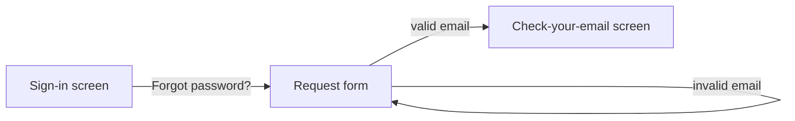

# Practice: UX design

## 1. Evidence first

Start from personas (`.sdd/product/personas.md`), the brief's jobs and pains, and any evidence the human provided (interviews, analytics, support tickets). Synthesize into: who, in what context/device, trying to do what, what goes wrong today. Unknowns → `ASM-nn`. If real user research would change the design materially, write a short **research plan** (questions, participants, method, what decision it informs) for the human to run — never invent research results.

## 2. Flows

One `UX-nn` per flow, mapped to REQs (`refs:`). Each flow: entry points, steps, decisions, exits (success and every failure from the ACs). Draw it in Mermaid:

Flows must not introduce capabilities the requirements don't contain — if they need one, file a finding to product-lead.

## 3. Screens and states

For each screen: purpose, primary action, content hierarchy, and **every state**:

| State | Must define |
|---|---|
| Empty | First use; what to do next |
| Loading | Skeleton or progress; when to show; timeout behavior |
| Partial | Some data failed or is still loading |
| Error | Message, cause in user terms, recovery action |
| Success | Confirmation and next step |
| Permission denied | Why, and what the user can do |
| Offline / slow network | Behavior, retries, what is preserved |

Responsive behavior per breakpoint (mobile first when the context is mobile).

## 4. Interaction and IA

Navigation model, labels from the glossary, consistent placement of primary actions, destructive actions confirmable or undoable, forms with inline validation that matches the API errors, keyboard paths, focus management on navigation and dialogs.

## 5. UX writing

Plain language, user's vocabulary (glossary), active voice, specific error messages ("This link has expired — request a new one" not "Error 410"), no blame, consistent tone from the design system. Every user-facing string is listed in `ux.md` with its key (for i18n).

## 6. Accessibility by design (WCAG 2.2 AA)

Semantic structure (headings, landmarks, lists), labels for every control, text alternatives, contrast ≥ 4.5:1 (3:1 for large text/UI parts), focus visible and ordered, target size ≥ 24×24 px, no information by color alone, motion respects reduced-motion, errors identified in text and associated with fields, no keyboard traps. Specify these in `ux.md`; they become ACs and axe checks.

## 7. Design system (project level)

`.sdd/product/design-system.md`: principles, tokens (color with contrast pairs, typography scale, spacing, radii, elevation, motion), components (purpose, variants, states, accessibility notes), patterns (forms, tables, empty states, notifications, dialogs), voice and tone. Prefer adopting an accessible component library that fits the frontend stack decision over inventing one.

## 8. Prototypes

When a flow is complex or contested, build a **low-fidelity static HTML prototype** in `specs/<f>/prototypes/` (no build step, no real data) to make the flow concrete for the human and engineers. It is a communication artifact, never shipped.

## 9. Reviewing built UI (ux-review)

Using the running app (Playwright) or screenshots from the evidence pack: each flow end to end, every state reachable, copy matches `ux.md`, accessibility (keyboard-only run, axe results, contrast), responsive behavior. Findings route to the engineer of the task (or product-lead if the spec is wrong).
