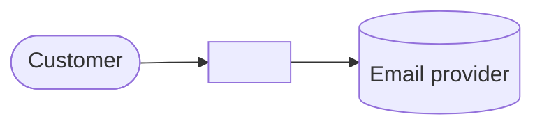

# Architecture overview: <product>

## System context
<!-- Who and what the system talks to. -->

## Containers
<!-- Deployables and datastores, with the technology of each (link ADRs). -->

## Module map
| Module | Responsibility | Owns data | Public interface | Depends on |
|---|---|---|---|---|

## Cross-cutting
<!-- AuthN/AuthZ, configuration, logging/tracing, error format, time, IDs, i18n. -->

## Key decisions
<!-- ADR list with one line each. -->
